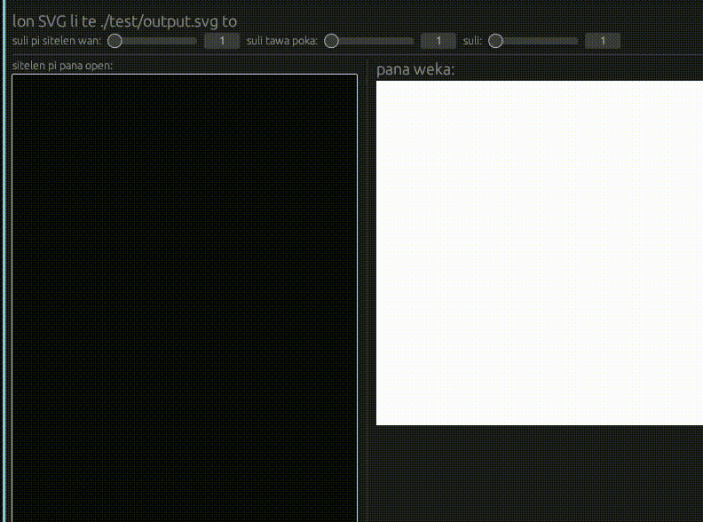
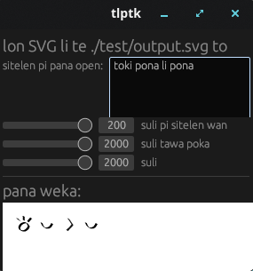

# toki lukin pi telo kule



The program creates a sitelen pona SVG.\
Commands and syntax below.

## Installation

I use an Ubuntu-based Linux distro.\
I use apt but you might not.\
If you use Windows you cannot use this tutorial.

Install Python:\
```sudo apt install python3.12-dev```

<!--   -->

Click "```Releases```"\
Download "```tlptk.tar.gz```" from GitHub\
Extract "```tlptk.tar.gz```"

## How To Use

### UI

Your extracted folder contains "```tlptk```"\
Run it using "```./tlptk```"\
The program continuously and automatically creates SVGs. When you are done click the x.



Output: ```tlptk/project/test/output.svg```

New SVGs replace old ones.

### Commands

Run "```python3 writer.py --help```"\
```python3 writer.py -w 200 -n './test/sin.tlptk' -p 1400 -s 600```

If you want to change the image format first run "```sudo apt install inkscape```".

Run "```python3 convert.py --help```"\
```python3 convert.py -n ./nimi.svg -l png -p 1000```

The input path is the same as the ouput path.

[syntax](./SYNTAX.md)
