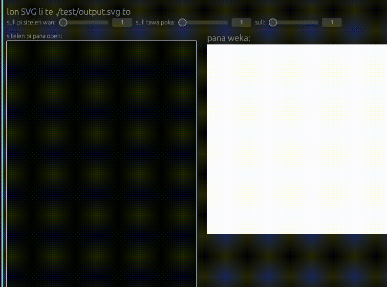
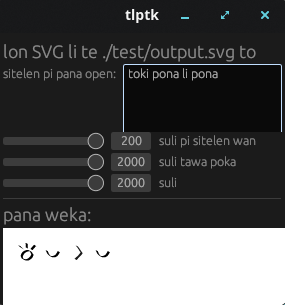

# toki lukin pi telo kule
[Read in English](./README-en.md)



ilo ni li pali e SVG pi sitelen pona.\
nasin lawa en nasin sitelen pi ilo ni li lon anpa.

## o jo

mi kepeken e ubuntu pi linux.\
mi kepeken e ilo apt. sina ken kepeken ala.\
sina kepeken windows la sina kepeken ala e lipu sona ni.

o wile jo e ilo python:\
```sudo apt install python3.12-dev```

<!--   -->

o luka lili te ```Releases``` to.\
o kama jo te ```tlptk.tar.gz``` to tan GitHub.\
o pali e kulupu tan ijo ```tlptk.tar.gz```.

## o kepeken

### lawa lukin

ilo kulupu pi ilo sona li jo e ilo te ```tlptk``` to.\
o open kepeken te ```./tlptk``` to.\
ilo ni li pali sin pi jan ala e lipu SVG. sina pini la sina luka lili e te ```X``` to.



pana weka: ```tlptk/project/test/output.svg```

lipu sin SVG li weka e lipu majuna SVG.

### nasin lawa

o open te ```python3 writer.py --help``` to.\
```python3 writer.py -w 200 -n './test/sin.tlptk' -p 1400 -s 600```

sina wile ante e sitelen lukin. sina kepeken te ```sudo apt install inkscape``` to.

o open te ```python3 convert.py --help``` to.\
```python3 convert.py -n ./nimi.svg -l png -p 1000```

nasin lon pi ilo sona pi pana open li sama e pana weka.

[nasin sitelen](./SYNTAX.md)
