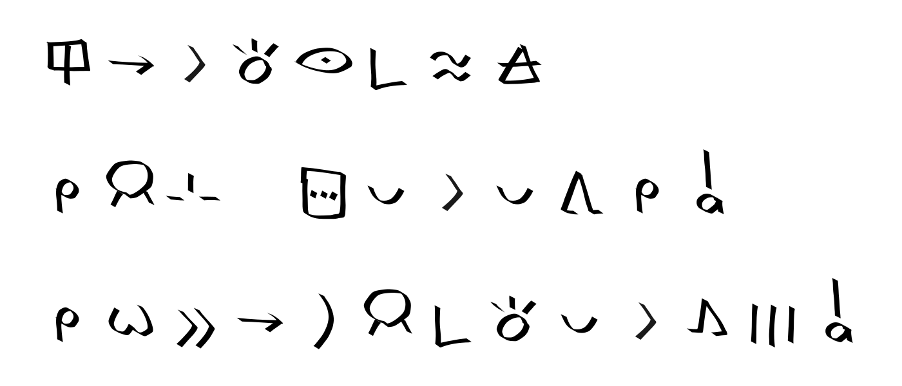

[↵](./README-en.md)
## Syntax

Spaces are represented by "```_```"\
Cartouches use "```[]```"\
Alternate glyphs use "```*```"\
The Latin alphabet uses ```''```\
The glyph "te" and the glyph "to" use double quotation marks.

```tlptk
nimi mi li [jan pi pipi luka]
"pipi luka"_'nimi mi li pona suli e toki inli taso'
'mi sona mute ala e toki pona'
ilo ni li toki lukin pi telo kule
mi jan sin_sitelen pona li pona tawa mi a
mi wile e ni la jan pi toki pona li kama mute a

kin nasin sitelen pi lukin "mute mute* sewi sewi*"
```
```python3 writer.py -w 200 -n './test/sin.tlptk' -p 4600 -s 1600```


