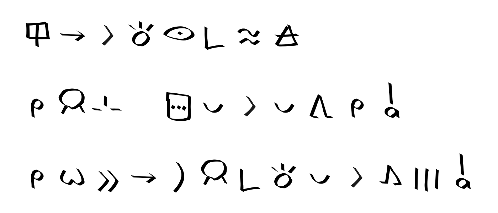

[↵](./README.md)
## nasin sitelen

sitelen wan pi sitelen weka li te ```_``` to.\
nimi poki li kepeken e te ```[]``` to.\
nimi ante li kepeken e te ```*``` to.\
sitelen lasina li kepeken e te ```''``` to.\
nimi te en nimi to li kepeken e te ```""``` to.

```tlptk
nimi mi li [jan pi pipi luka]
"pipi luka"_'nimi mi li pona suli e toki inli taso'
'mi sona mute ala e toki pona'
ilo ni li toki lukin pi telo kule
mi jan sin_sitelen pona li pona tawa mi a
mi wile e ni la jan pi toki pona li kama mute a

kin nasin sitelen pi lukin "mute mute* sewi sewi*"
```
```python3 writer.py -w 200 -n './test/sin.tlptk' -p 4600 -s 1600```


